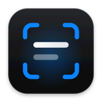
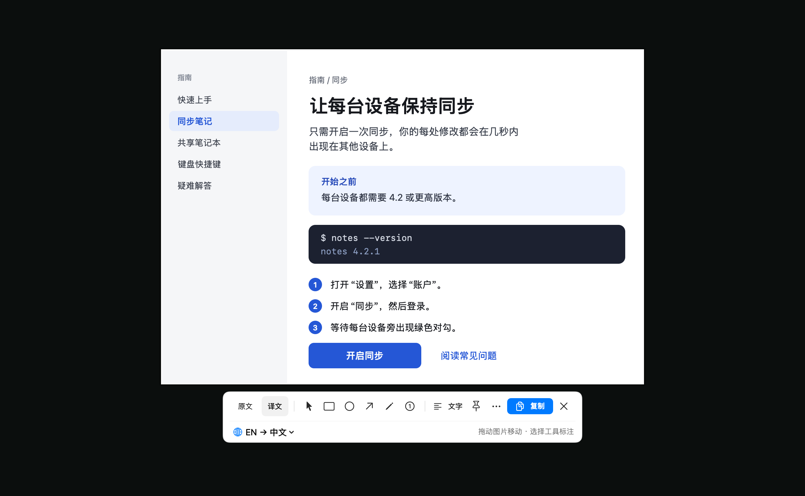

<p align="center"></p>
<h1 align="center">Transeen</h1>
<p align="center"><strong>Translation, right where it belongs.</strong><br />Capture, annotate, and translate any part of your screen. Native to your Mac.</p>
<p align="center">
  <a href="project.yml"></a>
  <a href="https://github.com/LiuTianjie/Transeen/actions/workflows/ci.yml"></a>
  <a href="LICENSE"></a>
</p>
<p align="center">
  <a href="https://github.com/LiuTianjie/Transeen/releases/latest">Download</a> ·
  <a href="https://transeen.itool.tech/">Website</a> (<a href="https://transeen.itool.tech/zh-hant/">繁中</a>, <a href="https://transeen.itool.tech/ja/">日本語</a>, <a href="https://transeen.itool.tech/ko/">한국어</a>, <a href="https://transeen.itool.tech/fr/">FR</a>, <a href="https://transeen.itool.tech/es/">ES</a>, <a href="https://transeen.itool.tech/de/">DE</a>) ·
  <a href="https://transeen.itool.tech/guide/">Setup guide</a> ·
  <a href="CHANGELOG.md">Changelog</a> ·
  <a href="README.zh-CN.md">简体中文</a>
</p>
<p align="center"></p>
<p align="center"><sub>Production rendering and native toolbar, with authored sample content and a fixed translation.</sub></p>

Transeen is a macOS menu bar app that keeps translation close to what you are reading. Select a screen region or open an image, translate the text in place, compare it with the original, then annotate, copy, save, or pin the result.

**The official app requires a Transeen TR- activation code.** Activate this Mac without signing in, or optionally bind the license to your iTool account. The source code is MIT licensed, including commercial use. [Licensing](LICENSING.md).

## What it does

- **Translate in place.** Local Vision OCR, pixel-aware text layout, and original/translation comparison. A full text view keeps longer translations readable.
- **Annotate independently.** Arrows, shapes, pen strokes, and numbered markers stay on a separate layer with undo and redo.
- **Choose a provider.** Apple on-device translation, a downloadable local translation model (Index-Translate 2B or Hy-MT2 1.8B, about 1.1 GB, Apple silicon), or an OpenAI-compatible remote model. Only the remote mode sends anything off the Mac, and then recognized text only, not screenshots.
- **Keep a small footprint.** Menu bar access, configurable shortcuts, pinned images, PNG export, and clipboard copy. No screenshot history or continuous capture.
- **Check for updates.** Choose “检查更新…” in the menu bar or launcher to find the latest GitHub release and its download.

## Get started

1. Download the universal Mac app from GitHub Releases, move it to Applications, and open it. Requires macOS 26 or later.
2. Open “激活与账号…” and enter your TR- code. SM- and IT- codes are different products.
3. The first-run guide walks through Screen Recording, translation languages, and downloading Apple language packs ahead of time.
4. Press F1 to select a region and translate it. On a laptop keyboard that is Fn–F1, unless the F keys are set to work as standard function keys. Every shortcut can be changed in Settings.

| Action | Default shortcut |
| --- | --- |
| Capture and translate | `F1` |
| Select the last captured area again | `R`, while selecting |
| Swap languages | `F1` again, while the result is open |
| Compare original and translation | `Tab` |
| Copy / save PNG | `⌘C` / `⌘S` |
| Undo / redo | `⌘Z` / `⌘⇧Z` |

Capturing for annotation and comparing from anywhere have no shortcut until you set one.

The current app interface is in Simplified Chinese. Translation supports the languages listed in the app.

## Build from source

Use Xcode 26.4 or later, Swift 6, and XcodeGen.

```sh
brew install xcodegen
./scripts/build.sh
```

The app is written to `dist/Transeen.app`. Without a Developer ID identity, the build uses ad-hoc signing. Set `TRANSEEN_SIGNING_IDENTITY` for a signed local build. Hosted activation access is separate from the MIT source license; configure your own licensing backend for an independent distribution.

```sh
./scripts/test.sh
./scripts/test-license.sh
./scripts/test-lifecycle.sh
```

The tests cover image layout, translation protocol, activation state, version comparisons, and capture lifecycle. Real Apple translation can be checked separately with `TRANSEEN_TEST_APPLE=1 ./scripts/test-lifecycle.sh` after installing the language packs.

## Privacy and limits

Screenshots, OCR and local-model translation stay on the Mac; the only network use of a local model is its one-time download. External model mode sends extracted text to the endpoint you choose. Licensing uses a random installation ID and a Keychain receipt, not hardware serial numbers. Update checks contact GitHub.

Dense layouts, specialist terminology, and formulas can still need correction. Translation quality depends on the provider. Always compare important details with the original.

## License

[MIT](LICENSE) © 2026 LiuTianjie.
