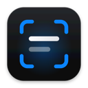
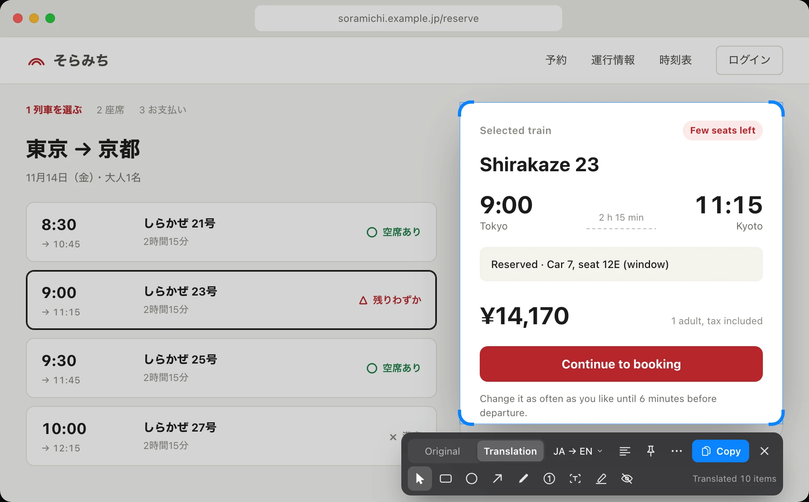

<p align="center"></p>
<h1 align="center">Transeen</h1>
<p align="center"><strong>Translation, right where it belongs.</strong><br />Capture, annotate, and translate any part of your screen. Native to your Mac.</p>
<p align="center">
  <a href="project.yml"></a>
  <a href="https://github.com/LiuTianjie/Transeen/actions/workflows/ci.yml"></a>
  <a href="LICENSE"></a>
</p>
<p align="center">
  <a href="https://github.com/LiuTianjie/Transeen/releases/latest">Download</a> ·
  <a href="https://transeen.itool.tech/">Website</a> (<a href="https://transeen.itool.tech/zh-hant/">繁中</a>, <a href="https://transeen.itool.tech/ja/">日本語</a>, <a href="https://transeen.itool.tech/ko/">한국어</a>, <a href="https://transeen.itool.tech/fr/">FR</a>, <a href="https://transeen.itool.tech/es/">ES</a>, <a href="https://transeen.itool.tech/de/">DE</a>) ·
  <a href="https://transeen.itool.tech/guide/">Setup guide</a> ·
  <a href="https://itool.tech/pro?from=transeen">iTool yearly membership · CNY 99/year</a> ·
  <a href="CHANGELOG.md">Changelog</a> ·
  <a href="README.zh-CN.md">简体中文</a>
</p>
<p align="center"></p>
<p align="center"><sub>Production rendering and native toolbar, with authored sample content and a fixed translation.</sub></p>

Transeen is a macOS menu bar app that keeps translation close to what you are reading. Select a screen region or open an image, translate the text in place, compare it with the original, then annotate, copy, save, or pin the result.

**The official app is included in the iTool yearly membership: CNY 99 a year for every iTool product.** [Get it on itool.tech](https://itool.tech/pro?from=transeen). Capture, markup, image import and translation need you to sign in to an iTool account (Google, GitHub or email) with the yearly membership. The source code is MIT licensed, including commercial use. [Licensing](LICENSING.md).

## What it does

- **Translate in place.** Local Vision OCR, pixel-aware text layout, and original/translation comparison. A full text view keeps longer translations readable.
- **Annotate independently.** Arrows, shapes, pen strokes, numbers, text, highlights and solid redactions stay on a separate layer with undo and redo. Double-click text to edit; ⌘Return commits and Esc cancels the edit. Redacted pixels are covered in exported images.
- **Choose a provider.** Apple on-device translation, a downloadable local translation model (Index-Translate 2B or Hy-MT2 1.8B, about 1.1 GB, Apple silicon), or an OpenAI-compatible remote model. Only the remote mode sends anything off the Mac, and then recognized text only, not screenshots.
- **Keep a small footprint.** Menu bar access, configurable shortcuts, pinned images, PNG export, and clipboard copy. Pins support scroll-to-zoom, ⌥scroll for opacity, thumbnail mode and click-through; show/hide or unlock all pins from the menu bar.
- **Updates.** Transeen checks for a new version once a day and, after you agree, downloads, verifies and installs it in place with [Sparkle](https://sparkle-project.org). “检查更新…” in the menu bar or launcher checks right away.

- **Scrolling capture.** Select scrolling content, start, scroll down while watching the preview, then finish and annotate. Optional auto-scroll requires Accessibility access. Vertical capture only, up to 30,000 pixels high / 60 million pixels. Animation, fixed sidebars or changing layouts can prevent alignment; the captured portion is retained and the problem is shown. Tall results support scrolling and zooming without reducing export resolution.
- **Recent captures.** Locally retain up to 50 captures / 200 MB for 7 days by default. Choose 1, 7 or 30 days; delete individual images or clear all. Disabling retention clears history. Restored images have flattened annotations, without hidden originals or undo layers.

## Get started

1. Download the universal Mac app from GitHub Releases, move it to Applications, and open it. Requires macOS 26 or later.
2. Open “账号与会员…” (Account & Membership…) and sign in to iTool. Without the yearly membership, choose the upgrade button, pay on [itool.tech](https://itool.tech/pro?from=transeen), then choose Refresh Membership. The monthly membership covers the iTool website and LinkShell, not Transeen.
3. The four-step guide lets you try an interactive sample, choose your reading language, prepare screen access and start your first capture. It remembers your place; the sample needs no sign-in or permission. Prepare a language pack, local model or API in translation settings, or start with annotation.
4. Press F1 to select a region and translate it. On a laptop keyboard that is Fn–F1, unless the F keys are set to work as standard function keys. Every shortcut can be changed in Settings.

| Action | Default shortcut |
| --- | --- |
| Capture and translate | `F1` |
| Select the last captured area again | `R`, while selecting |
| Swap languages | `F1` again, while the result is open |
| Toggle original and translation | `Tab` / `Space` |
| Copy / save PNG | `⌘C` / `⌘S` |
| Undo / redo | `⌘Z` / `⌘⇧Z` |

Capturing for annotation and comparing from anywhere have no shortcut until you set one.

The interface and translation support Simplified Chinese, Traditional Chinese, English, Japanese, Korean, French, Spanish and German. Space and comparison shortcuts toggle on each press; releasing the key does not switch back.

## Build from source

Use Xcode 26.4 or later, Swift 6, and XcodeGen.

```sh
brew install xcodegen
./scripts/build.sh
```

The app is written to `dist/Transeen.app`. Without a Developer ID identity, the build uses ad-hoc signing. Set `TRANSEEN_SIGNING_IDENTITY` for a signed local build. Only Developer ID builds read the update feed; ad-hoc builds link to the GitHub release instead. Release steps are in [docs/RELEASING.md](docs/RELEASING.md). The hosted iTool membership check is separate from the MIT source license; configure your own account backend for an independent distribution.

```sh
./scripts/test.sh
./scripts/test-license.sh
./scripts/test-lifecycle.sh
./scripts/test-capture-tools.sh
```

The tests cover image layout, translation protocol, the membership gate and its offline rules, version comparisons, and capture lifecycle. Real Apple translation can be checked separately with `TRANSEEN_TEST_APPLE=1 ./scripts/test-lifecycle.sh` after installing the language packs.

## Privacy and limits

Screenshots, OCR and local-model translation stay on the Mac; the only network use of a local model is its one-time download. External model mode sends extracted text to the endpoint you choose. The membership check sends your iTool sign-in token to itool.tech (or Supabase as a fallback); the sign-in and the last check are kept in the Keychain, and hardware serial numbers are never read. Update checks read the feed on transeen.itool.tech and download from GitHub Releases; they send no system profile.

Dense layouts, specialist terminology, and formulas can still need correction. Translation quality depends on the provider. Always compare important details with the original.

## License

[MIT](LICENSE) © 2026 LiuTianjie.
