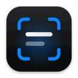
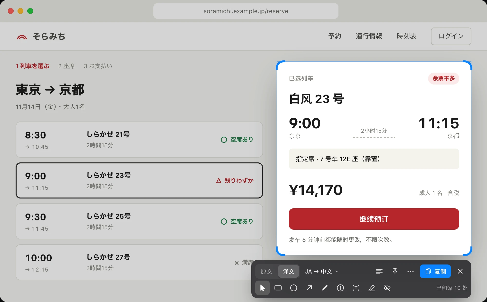

<p align="center"></p>
<h1 align="center">Transeen</h1>
<p align="center"><strong>让译文留在原处。</strong><br />框选屏幕，在原处读懂。原生 Mac 截图、标注与翻译工具。</p>
<p align="center">
  <a href="project.yml"></a>
  <a href="https://github.com/LiuTianjie/Transeen/actions/workflows/ci.yml"></a>
  <a href="LICENSE"></a>
</p>
<p align="center">
  <a href="https://github.com/LiuTianjie/Transeen/releases/latest">下载</a> ·
  <a href="https://transeen.itool.tech/zh/">官网</a> ·
  <a href="https://transeen.itool.tech/zh/guide/">使用指南</a> ·
  <a href="https://wzyp.cn/item/gq2xie">购买激活码 · ¥49.90</a> ·
  <a href="CHANGELOG.md">更新记录</a> ·
  <a href="README.md">English</a>
</p>
<p align="center"></p>
<p align="center"><sub>使用演示内容与固定译文，展示真实渲染和原生工具栏。</sub></p>

Transeen 是一款 macOS 菜单栏应用。框选屏幕区域或打开图片，在原处查看译文、对照原文，再标注、复制、保存或钉住结果。

**官方应用需要 Transeen 专用 TR- 激活码，¥49.90，一台 Mac 永久授权。** [前往链动小铺购买](https://wzyp.cn/item/gq2xie)。 无需登录即可激活本机，也可以选择绑定 iTool 账号。源代码采用 MIT 许可证，允许商业使用。 [Licensing](LICENSING.md).

## 主要功能

- **原位翻译。** 本机 Vision OCR，结合像素样式排版，随时对照原文；长译文可以在完整文字视图中阅读。
- **独立标注。** 箭头、形状、画笔、编号、文字、高亮和实色隐私遮挡保留在独立图层，支持撤销与重做。双击文字可编辑，⌘Return 完成，Esc 取消编辑；遮挡在导出时覆盖原始像素。
- **自选翻译服务。** Apple 本机翻译；可下载的本地翻译模型（Index-Translate 2B 或 Hy-MT2 1.8B，约 1.1 GB，需 Apple 芯片）；或兼容 OpenAI 的远端模型。只有远端模式会把内容发出本机，而且只发送识别文字，不发送截图。
- **轻巧的原生工具。** 菜单栏入口、自定义快捷键、钉图、PNG 导出与复制。钉图支持滚轮缩放、⌥滚轮调透明度、双击缩略图和鼠标穿透；可从菜单栏统一隐藏或解除穿透。
- **滚动长截图。** 框选滚动内容，点击开始，手动向下滚动并查看拼接预览，点击完成后继续标注。可选择自动滚动（需要辅助功能权限）；只支持纵向。固定侧栏、动画或布局变化可能导致无法对齐，此时保留已拼接内容并提示。最长 30,000 像素、最多 6,000 万像素。长图支持滚动查看和缩放，导出保留原始分辨率。
- **最近截图恢复。** 默认本地保留 7 天，最多 50 张 / 200 MB；可选 1 / 7 / 30 天、删除单张或清空，关闭保留会删除记录。记录为已合并标注的图片，不保存被遮挡的底图或标注撤销历史。
- **检查更新。** 从菜单栏或启动面板选择“检查更新…”，查看最新 GitHub 版本与下载入口。

## 开始使用

1. 从 GitHub Releases 下载 Mac 通用版本，移入“应用程序”后打开。需要 macOS 26 或更高版本。
2. 打开“激活与账号…”，输入 TR- 激活码。SM- 和 IT- 是其他产品的激活码，不能通用。
3. 四步引导依次体验交互示例、选择阅读语言、准备截屏权限、开始第一次截图，会记住当前进度。示例无需激活或授权；在翻译设置中准备语言包、本地模型或接口，也可以先使用截图标注。
4. 按 F1 框选翻译。笔记本键盘上是 Fn–F1，除非在系统设置里把 F 键设为标准功能键。所有快捷键都可以在设置里修改。

| 操作 | 默认快捷键 |
| --- | --- |
| 截图翻译 | `F1` |
| 选择上次截图的区域 | 框选时按 `R` |
| 交换语言 | 结果打开时再按 `F1` |
| 切换原文与译文（再按一次切回） | `Tab` / `空格` |
| 复制 / 保存 PNG | `⌘C` / `⌘S` |
| 撤销 / 重做 | `⌘Z` / `⌘⇧Z` |

截图标注和全局对照原文默认没有快捷键，需要时在设置里添加。

界面与翻译均支持简体中文、繁体中文、英语、日语、韩语、法语、西班牙语和德语。空格及对照快捷键均为按一次切换，再按一次切回，松开不会恢复。

## 从源码构建

需要 Xcode 26.4 或更高版本、Swift 6 与 XcodeGen。

```sh
brew install xcodegen
./scripts/build.sh
```

应用生成于 `dist/Transeen.app`。没有 Developer ID 身份时使用临时签名；签名构建可设置 `TRANSEEN_SIGNING_IDENTITY`。托管激活服务与 MIT 源码许可分开；独立分发应配置自己的授权后端。

```sh
./scripts/test.sh
./scripts/test-license.sh
./scripts/test-lifecycle.sh
./scripts/test-capture-tools.sh
```

测试覆盖图像排版、翻译协议、授权状态、版本比较和截图生命周期。安装语言包后，可用 `TRANSEEN_TEST_APPLE=1 ./scripts/test-lifecycle.sh` 单独验证真实 Apple 翻译。

## 隐私与边界

截图、OCR 和本地模型翻译都在本机处理，本地模型只在下载时联网一次。外部模型模式会将识别文字发送至你选择的接口。授权使用随机安装 ID 与钥匙串回执，不读取硬件序列号。检查更新会访问 GitHub。

密集排版、专业术语和公式仍可能需要修正。翻译质量取决于所选服务，重要内容请对照原文核实。

## License

[MIT](LICENSE) © 2026 LiuTianjie.
